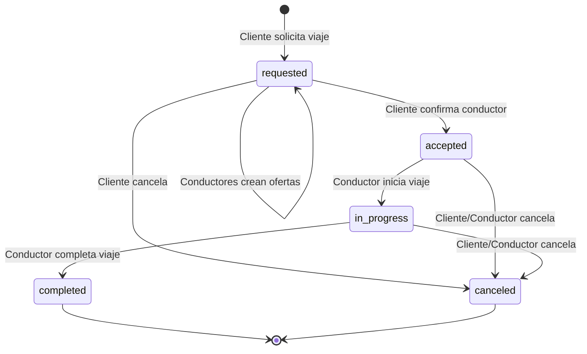

# Flujo de Estados Corregido - Sistema de Ofertas Múltiples

## Problema Identificado

El backend tiene código legacy que menciona `driver_assigned`, pero el nuevo sistema de ofertas múltiples NO usa ese estado. Esto causa confusión en el flujo.

## Estados Válidos en el Nuevo Sistema

### 1. `requested` (Viaje Disponible)
**Cuándo:** Cliente solicita viaje
**Qué pasa:**
- Viaje creado en `activeRides/${rideId}`
- `status: 'requested'`
- `offers: {}` (vacío)
- `offersCount: 0`
- `rejectedDrivers: []`

**Conductores pueden:**
- ✅ Ver el viaje en `AvailableRidesScreen`
- ✅ Crear ofertas con `acceptRide()`
- ✅ Negociar precio

**Cliente puede:**
- ✅ Ver ofertas en `RideConfirmationScreen`
- ✅ Cancelar viaje

---

### 2. `accepted` (Conductor Confirmado)
**Cuándo:** Cliente selecciona un conductor con `confirmDriver()`
**Qué pasa:**
- `status: 'accepted'`
- `driverId: selectedDriverId`
- `driver: { name, rating, phone }`
- `vehicle: { plate, brand, model, color }`
- `finalFare: offeredPrice`
- `offers/${selectedDriverId}/status: 'accepted'`
- `offers/${otherDrivers}/status: 'rejected'`
- `rejectedDrivers: [driverId1, driverId2, ...]`

**Conductor seleccionado puede:**
- ✅ Iniciar viaje con `startRide()`
- ✅ Ver info del cliente
- ✅ Navegar al punto de recogida

**Conductores rechazados:**
- ❌ Reciben notificación
- ❌ Viaje desaparece de su lista
- ❌ No pueden volver a ofertar

**Cliente puede:**
- ✅ Ver ubicación del conductor en tiempo real
- ✅ Chatear con conductor
- ✅ Cancelar viaje (con penalización si progreso ≥60%)

---

### 3. `in_progress` (Viaje en Curso)
**Cuándo:** Conductor inicia viaje con `startRide()`
**Qué pasa:**
- `status: 'in_progress'`
- `startedAt: timestamp`
- Tracking en tiempo real activo
- `paymentStatus/${rideId}/status: 'in_progress'`

**Conductor puede:**
- ✅ Completar viaje con `completeRide()`
- ✅ Ver ruta en tiempo real
- ✅ Chatear con cliente
- ✅ Cancelar viaje (con penalización si progreso ≥25%)

**Cliente puede:**
- ✅ Ver ubicación del conductor en tiempo real
- ✅ Ver ETA dinámico
- ✅ Recibir alertas de desvío
- ✅ Chatear con conductor
- ✅ Cancelar viaje (con cargo si progreso ≥60%)

---

### 4. `completed` (Viaje Completado)
**Cuándo:** Conductor completa viaje con `completeRide()`
**Qué pasa:**
- `status: 'completed'`
- `completedAt: timestamp`
- `finalFare: actualFare`
- `actualDistance: meters`
- `actualDuration: seconds`
- `paymentStatus/${rideId}/status: 'pending_capture'`

**Ambos pueden:**
- ✅ Calificar al otro
- ✅ Ver resumen del viaje
- ✅ Descargar recibo

---

### 5. `canceled` (Viaje Cancelado)
**Cuándo:** Cliente o conductor cancela con `cancelRide()`
**Qué pasa:**
- `status: 'canceled'`
- `canceledAt: timestamp`
- `cancelReason: string`
- `canceledBy: 'client' | 'driver'`
- `paymentStatus/${rideId}/status: 'canceled'`

**Manejo de pagos:**
- Cliente cancela con <60% progreso: Sin cargo
- Cliente cancela con ≥60% progreso: Cargo proporcional
- Conductor cancela con ≥25% progreso: Penalización

---

## ❌ Estado ELIMINADO: `driver_assigned`

**Este estado NO existe en el nuevo sistema de ofertas múltiples.**

### Antes (Sistema Antiguo - DEPRECADO):
```
requested → driver_assigned → accepted → in_progress → completed
```

### Ahora (Sistema Nuevo - CORRECTO):
```
requested → accepted → in_progress → completed
              ↓
         (ofertas múltiples)
```

---

## Flujo Completo Paso a Paso

### Paso 1: Cliente Solicita Viaje
```typescript
// Frontend: SearchRideScreen
await ridesService.requestRide({ ... });

// Backend: requestRide()
activeRides/${rideId} = {
  status: 'requested',
  offers: {},
  offersCount: 0,
  rejectedDrivers: []
}
```

### Paso 2: Conductores Crean Ofertas
```typescript
// Frontend: AvailableRidesScreen
await ridesService.acceptRide(rideId, { offeredPrice });

// Backend: acceptRide()
activeRides/${rideId}/offers/${driverId} = {
  driverId,
  driver: { name, rating, phone },
  vehicle: { plate, brand, model, color },
  offeredPrice,
  distanceToPickup,
  status: 'pending',
  createdAt: timestamp
}

// Estado del viaje NO cambia
activeRides/${rideId}.status = 'requested' // ✅ Sigue igual
```

**Conductor navega a:**
```typescript
navigation.replace('WaitingClientConfirmation', {
  rideId,
  clientId,
  origin,
  destination,
  estimatedFare
});
```

### Paso 3: Cliente Ve Ofertas
```typescript
// Frontend: RideConfirmationScreen
// Listener en tiempo real:
const offersArray = Object.entries(ride.offers).map(([driverId, offer]) => ({
  ...offer,
  driverId
}));

// Cliente puede:
// - Ver todas las ofertas
// - Comparar precios, ratings, distancias
// - Negociar precio
// - Aceptar una oferta
// - Rechazar ofertas
```

### Paso 4A: Cliente Acepta Conductor
```typescript
// Frontend: RideConfirmationScreen
await ridesService.confirmDriver(rideId, selectedDriverId);

// Backend: confirmDriver()
activeRides/${rideId} = {
  status: 'accepted', // ✅ Cambia a accepted
  driverId: selectedDriverId,
  driver: { ... },
  vehicle: { ... },
  finalFare: offeredPrice,
  offers: {
    [selectedDriverId]: { status: 'accepted' },
    [otherDriver1]: { status: 'rejected' },
    [otherDriver2]: { status: 'rejected' }
  },
  rejectedDrivers: [otherDriver1, otherDriver2]
}
```

**Conductor seleccionado:**
- Listener detecta `status: 'accepted'`
- Navega automáticamente a `ActiveRideScreen`

**Conductores rechazados:**
- Listener detecta `offers/${driverId}/status: 'rejected'`
- Reciben notificación
- Regresan a `AvailableRidesScreen`

### Paso 4B: Cliente Rechaza Conductor
```typescript
// Frontend: RideConfirmationScreen
await ridesService.rejectDriver(rideId, driverId);

// Backend: rejectDriver()
activeRides/${rideId}/offers/${driverId}/status = 'rejected'
activeRides/${rideId}/rejectedDrivers.push(driverId)

// Estado del viaje NO cambia
activeRides/${rideId}.status = 'requested' // ✅ Sigue igual
```

**Conductor rechazado:**
- Listener detecta `offers/${driverId}/status: 'rejected'`
- Recibe notificación
- Regresa a `AvailableRidesScreen`

**Viaje:**
- Sigue disponible para otros conductores
- Conductores rechazados NO pueden volver a ofertar

### Paso 5: Conductor Inicia Viaje
```typescript
// Frontend: ActiveRideScreen
await ridesService.startRide(rideId);

// Backend: startRide()
activeRides/${rideId} = {
  status: 'in_progress', // ✅ Cambia a in_progress
  startedAt: timestamp
}

paymentStatus/${rideId}.status = 'in_progress'
```

### Paso 6: Conductor Completa Viaje
```typescript
// Frontend: ActiveRideScreen
await ridesService.completeRide(rideId, { finalFare, actualDistance });

// Backend: completeRide()
activeRides/${rideId} = {
  status: 'completed', // ✅ Cambia a completed
  completedAt: timestamp,
  finalFare,
  actualDistance,
  actualDuration
}

paymentStatus/${rideId}.status = 'pending_capture'
```

---

## Correcciones Necesarias en el Backend

### 1. Eliminar Referencias a `driver_assigned`

**Archivo:** `functions/src/api/rides.ts`

**Línea 282:** ❌ Código incorrecto
```typescript
// Permitir confirmar si está en 'requested' o 'driver_assigned' (cuando conductor aceptó precio)
if (ride.status !== 'requested' && ride.status !== 'driver_assigned') {
```

**Corrección:** ✅
```typescript
// Permitir confirmar solo si está en 'requested'
if (ride.status !== 'requested') {
```

**Razón:** El estado `driver_assigned` no existe en el nuevo sistema.

---

### 2. Mejorar Función `rejectDriver()`

**Problema:** Cuando cliente rechaza conductor, el conductor debe ser notificado inmediatamente.

**Mejora:** Agregar listener en `WaitingClientConfirmationScreen` para detectar rechazo.

---

### 3. Agregar Validación en `acceptRide()`

**Problema:** Un conductor puede crear múltiples ofertas para el mismo viaje.

**Mejora:**
```typescript
// Verificar si el conductor ya tiene una oferta
const existingOfferSnapshot = await admin.database()
  .ref(`activeRides/${rideId}/offers/${driverId}`)
  .once('value');

if (existingOfferSnapshot.exists()) {
  throw new functions.https.HttpsError(
    'already-exists',
    'Ya tienes una oferta activa para este viaje'
  );
}
```

---

## Diagrama de Estados



---

## Testing del Flujo

### Test 1: Múltiples Ofertas
1. ✅ Cliente solicita viaje → `status: 'requested'`
2. ✅ Conductor A acepta → Oferta creada, estado sigue `requested`
3. ✅ Conductor B acepta → Oferta creada, estado sigue `requested`
4. ✅ Cliente ve 2 ofertas
5. ✅ Cliente acepta Conductor A → `status: 'accepted'`
6. ✅ Conductor A navega a `ActiveRideScreen`
7. ✅ Conductor B recibe notificación de rechazo
8. ✅ Conductor B regresa a `AvailableRidesScreen`

### Test 2: Rechazo Individual
1. ✅ Cliente solicita viaje → `status: 'requested'`
2. ✅ Conductor A acepta → Oferta creada
3. ✅ Cliente rechaza Conductor A
4. ✅ Conductor A recibe notificación
5. ✅ Conductor A regresa a `AvailableRidesScreen`
6. ✅ Viaje sigue disponible (`status: 'requested'`)
7. ✅ Conductor B puede ofertar
8. ✅ Conductor A NO puede volver a ofertar

### Test 3: Navegación con "Ver en Mapa"
1. ✅ Cliente ve oferta de conductor
2. ✅ Cliente presiona "Ver en Mapa"
3. ✅ Navega a `RideTrackingScreen` (preview)
4. ✅ Cliente presiona "Regresar"
5. ✅ Regresa a `RideConfirmationScreen` ✅
6. ✅ Puede aceptar o rechazar conductor

---

## Resumen de Cambios

### Backend (functions/src/api/rides.ts):
1. ✅ Eliminar referencia a `driver_assigned` en línea 282
2. ✅ Agregar validación de oferta duplicada en `acceptRide()`
3. ✅ Mejorar notificaciones en `rejectDriver()`

### Frontend:
1. ✅ `RideConfirmationScreen`: Usar `navigate` en lugar de `replace`
2. ✅ `AvailableRidesScreen`: Navegar a `WaitingClientConfirmation`
3. ✅ `WaitingClientConfirmationScreen`: Nueva pantalla de espera
4. ✅ `DriverStack`: Agregar nueva ruta

### Documentación:
1. ✅ `FLUJO_CONFIRMACION_CONDUCTOR_FIX.md`
2. ✅ `FLUJO_ESTADOS_CORREGIDO.md` (este archivo)

---

## Fecha de Corrección
**2025-10-16**

---

## Próximos Pasos

1. ✅ Aplicar correcciones al backend
2. ✅ Redesplegar Firebase Functions
3. ✅ Testing E2E del flujo completo
4. ⏳ Actualizar documentación de API
5. ⏳ Crear tests automatizados
