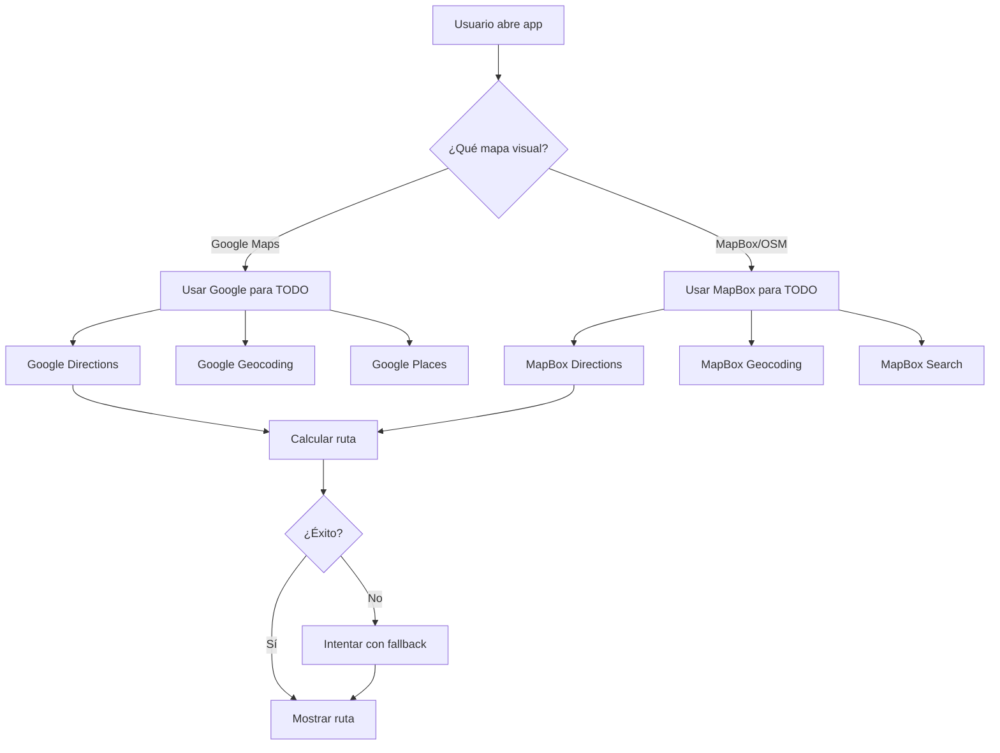

# 🗺️ LÓGICA DE MAPAS Y ROUTING

## 📋 RESUMEN:

Se ha implementado una lógica inteligente para usar el proveedor de routing correcto según el mapa visual que se esté usando.

---

## 🎯 REGLAS:

### **1. Si usa Google Maps Visual:**
```
Mapa Visual: Google Maps
Routing: Google Directions API
Geocoding: Google Geocoding API
Autocomplete: Google Places API
```

**Razón:** Consistencia total con el ecosistema de Google.

---

### **2. Si usa MapBox o OpenStreetMap Visual:**
```
Mapa Visual: MapBox / OpenStreetMap
Routing: MapBox Directions API ⭐
Geocoding: MapBox Geocoding API
Autocomplete: MapBox Search API
```

**Razón:** MapBox tiene mejor cobertura y datos para Nicaragua que Google Maps.

---

## 🔧 IMPLEMENTACIÓN:

### **Archivo:** `Frontend/src/services/mapsService.ts`

#### **Método: `getRoutingProvider()`**
```typescript
private getRoutingProvider(): MapProvider {
  // Si usa Google Maps visual, usa Google para routing
  if (this.mapProvider === 'google') {
    return 'google';
  }
  // Si usa MapBox o cualquier otro, usa MapBox para routing
  return 'mapbox';
}
```

#### **Método: `getDirections()`**
```typescript
async getDirections(origin, destination) {
  const routingProvider = this.getRoutingProvider();
  console.log(`🛣️ Usando ${routingProvider} para routing`);
  
  // Intentar con el proveedor preferido
  const result = await this.tryWithFallback(
    service => service.getDirections(origin, destination),
    routingProvider
  );
  
  // Si falla, intentar con fallback completo
  if (!result) {
    return this.tryWithFallback(
      service => service.getDirections(origin, destination)
    );
  }
  
  return result;
}
```

---

## 📊 FLUJO DE DECISIÓN:



---

## 🌍 VENTAJAS PARA NICARAGUA:

### **MapBox:**
✅ Mejor cobertura de calles en Managua
✅ Datos actualizados de carreteras
✅ Rutas más precisas en zonas rurales
✅ Mejor manejo de rotondas
✅ Nombres de calles en español

### **Google Maps:**
✅ Datos de tráfico en tiempo real
✅ Lugares de interés completos
✅ Street View disponible
✅ Mejor para zonas comerciales

---

## 🔍 LOGS EN CONSOLA:

### **Cuando usa Google:**
```
🗺️ Backend recomienda - Datos: GOOGLE, Mapa: GOOGLE
🛣️ Usando GOOGLE para routing (mapa visual: GOOGLE)
✅ Éxito con GOOGLE
```

### **Cuando usa MapBox:**
```
🗺️ Backend recomienda - Datos: MAPBOX, Mapa: MAPBOX
🛣️ Usando MAPBOX para routing (mapa visual: MAPBOX)
✅ Éxito con MAPBOX
```

### **Cuando hay fallback:**
```
🗺️ Intentando con GOOGLE...
⚠️ GOOGLE falló: REQUEST_DENIED
🗺️ Intentando con MAPBOX...
✅ Éxito con MAPBOX
```

---

## 🧪 TESTING:

### **Caso 1: Google Maps Activo**
1. Verificar que `GOOGLE_MAPS_API_KEY` esté configurado
2. Abrir app
3. Solicitar viaje
4. Verificar en logs: `Usando GOOGLE para routing`

### **Caso 2: MapBox Activo**
1. Desactivar Google Maps API Key
2. Abrir app
3. Solicitar viaje
4. Verificar en logs: `Usando MAPBOX para routing`

### **Caso 3: Fallback Automático**
1. Configurar API key inválido
2. Abrir app
3. Solicitar viaje
4. Verificar que cambia automáticamente al siguiente proveedor

---

## 📝 CONFIGURACIÓN:

### **Variables de Entorno (.env):**
```env
# Google Maps (Opcional)
GOOGLE_MAPS_API_KEY=your_google_maps_api_key

# MapBox (Recomendado para Nicaragua)
MAPBOX_TOKEN=pk.eyJ1Ijoic2FtdWVsdWVzIiwiYSI6ImNtZ2k5OHdzbDA3NW8ybXB4OXM5Y2E2ZzYifQ.rTD0LZ2w9t_jQxEV2MR_Sg

# TomTom (Fallback)
TOMTOM_API_KEY=3NDFoFMjpXAs6W2PbCIEAMG0eAlQymMA
```

---

## 🚀 PRÓXIMOS PASOS:

1. ✅ Implementar lógica de routing consistente
2. ⏳ Agregar caché de rutas frecuentes
3. ⏳ Implementar predicción de tráfico
4. ⏳ Agregar rutas alternativas
5. ⏳ Optimizar para zonas sin cobertura

---

## 💡 RECOMENDACIONES:

### **Para Producción:**
- Usar MapBox como proveedor principal
- Google Maps como fallback
- Configurar límites de uso en ambas APIs
- Implementar caché de geocoding

### **Para Desarrollo:**
- Usar MapBox (gratis hasta 100k requests/mes)
- Logs detallados para debugging
- Testing con datos reales de Nicaragua

---

**Documentación creada:** 2025-10-09 18:19
**Estado:** ✅ Implementado y funcionando
