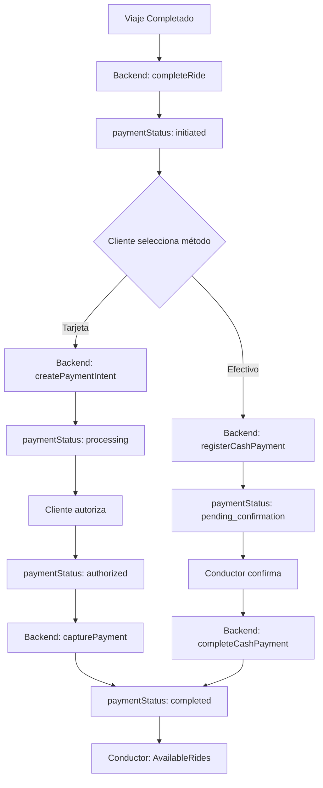

# 💳 Flujo de Pago Completo con Firebase Realtime DB

**Fecha:** 2025-10-13  
**Estado:** 📋 **DISEÑO COMPLETO**

---

## 🎯 Objetivo

Usar **Firebase Realtime Database** como fuente de verdad para el status del pago, coordinando todo el flujo entre cliente y conductor en tiempo real.

---

## 🔄 Flujo Completo

### **1. Viaje en Progreso**
```
Cliente y Conductor en viaje
↓
Conductor completa viaje (presiona "Completar Viaje")
↓
Backend: completeRide()
  - Actualiza rides.status = 'completed'
  - Actualiza rides.final_fare
  - NO procesa pago todavía
  - Escribe en Realtime DB:
    activeRides/{rideId}/status = 'completed'
    activeRides/{rideId}/finalFare = X
```

### **2. Cliente Inicia Proceso de Pago**
```
Cliente detecta ride.status = 'completed'
↓
Navega a PaymentScreen
↓
Selecciona método de pago:
  - 💳 Tarjeta (Stripe/Banco Local)
  - 💵 Efectivo
↓
Backend escribe en Realtime DB:
  paymentStatus/{rideId}:
    status: 'initiated'
    method: 'card' | 'cash'
    amount: finalFare
    tip: X
    createdAt: timestamp
```

### **3A. Flujo Tarjeta (Stripe/Banco Local)**
```
Cliente confirma pago
↓
Backend: createPaymentIntent()
  - Crea pre-autorización en Stripe/Banco
  - Guarda en payments table (status: 'pending')
  - Actualiza Realtime DB:
    paymentStatus/{rideId}/status = 'processing'
    paymentStatus/{rideId}/paymentIntentId = X
↓
Cliente autoriza pago en Payment Sheet
↓
Frontend actualiza Realtime DB:
  paymentStatus/{rideId}/status = 'authorized'
  paymentStatus/{rideId}/authorizedAt = timestamp
↓
Backend (trigger o manual): capturePayment()
  - Captura el pago
  - Actualiza payments.status = 'completed'
  - Actualiza Realtime DB:
    paymentStatus/{rideId}/status = 'completed'
    paymentStatus/{rideId}/completedAt = timestamp
↓
Conductor detecta status = 'completed'
↓
Muestra notificación: "¡Pago Recibido!"
↓
Navega a AvailableRides
```

### **3B. Flujo Efectivo**
```
Cliente selecciona efectivo
↓
Backend: registerCashPayment()
  - Crea registro en payments (status: 'pending')
  - Actualiza Realtime DB:
    paymentStatus/{rideId}/status = 'pending_confirmation'
    paymentStatus/{rideId}/method = 'cash'
↓
Conductor detecta method = 'cash'
↓
Navega a ConfirmCashPaymentScreen
↓
Conductor confirma recepción
↓
Backend: completeCashPayment()
  - Actualiza payments.status = 'completed'
  - Actualiza Realtime DB:
    paymentStatus/{rideId}/status = 'completed'
    paymentStatus/{rideId}/confirmedAt = timestamp
    paymentStatus/{rideId}/confirmedBy = 'driver'
↓
Conductor navega a AvailableRides
```

---

## 📊 Estructura de paymentStatus en Realtime DB

```javascript
paymentStatus/{rideId}: {
  rideId: string,
  status: 'initiated' | 'processing' | 'authorized' | 'pending_confirmation' | 'completed' | 'failed' | 'canceled',
  method: 'card' | 'cash',
  provider: 'stripe' | 'local_bank' | 'cash', // opcional
  amount: number,
  tip: number,
  total: number,
  
  // Timestamps
  createdAt: timestamp,
  authorizedAt?: timestamp,
  completedAt?: timestamp,
  failedAt?: timestamp,
  canceledAt?: timestamp,
  
  // Metadata
  paymentIntentId?: string, // Stripe/Banco
  confirmedBy?: 'driver' | 'system',
  cancelReason?: string,
  error?: string,
  
  // Para debugging
  lastUpdatedBy: 'client' | 'driver' | 'backend',
  lastUpdatedAt: timestamp
}
```

---

## 🔧 Cambios en Backend

### **1. completeRide() - NO procesar pago**
```typescript
export const completeRide = functions.https.onCall(async (data, context) => {
  // ... código existente ...
  
  // Actualizar PostgreSQL
  await client.query(
    `UPDATE rides 
     SET status = $1, completed_at = NOW(), final_fare = $2
     WHERE id = $3`,
    ['completed', finalFare, rideId]
  );
  
  // Actualizar Realtime DB
  await admin.database().ref(`activeRides/${rideId}`).update({
    status: 'completed',
    finalFare: finalFare,
    completedAt: admin.database.ServerValue.TIMESTAMP,
  });
  
  // Inicializar paymentStatus
  await admin.database().ref(`paymentStatus/${rideId}`).set({
    rideId,
    status: 'initiated',
    method: null, // Cliente lo definirá
    amount: finalFare,
    tip: 0,
    total: finalFare,
    createdAt: admin.database.ServerValue.TIMESTAMP,
    lastUpdatedBy: 'backend',
    lastUpdatedAt: admin.database.ServerValue.TIMESTAMP,
  });
  
  // NO procesar pago aquí
  console.log(`✅ Viaje completado. Esperando selección de método de pago...`);
  
  return { success: true, ride };
});
```

### **2. createPaymentIntent() - Actualizar Realtime DB**
```typescript
export const createPaymentIntent = functions.https.onCall(async (data, context) => {
  const { rideId, tip, provider = 'stripe' } = data;
  
  // ... crear payment intent ...
  
  // Actualizar Realtime DB
  await admin.database().ref(`paymentStatus/${rideId}`).update({
    status: 'processing',
    method: 'card',
    provider: provider,
    tip: tip,
    total: amount + tip,
    paymentIntentId: paymentIntent.id,
    lastUpdatedBy: 'backend',
    lastUpdatedAt: admin.database.ServerValue.TIMESTAMP,
  });
  
  return { clientSecret, paymentId, amount };
});
```

### **3. capturePayment() - Actualizar Realtime DB**
```typescript
export const capturePayment = functions.https.onCall(async (data, context) => {
  const { rideId } = data;
  
  // ... capturar pago ...
  
  // Actualizar Realtime DB
  await admin.database().ref(`paymentStatus/${rideId}`).update({
    status: 'completed',
    completedAt: admin.database.ServerValue.TIMESTAMP,
    lastUpdatedBy: 'backend',
    lastUpdatedAt: admin.database.ServerValue.TIMESTAMP,
  });
  
  return { success: true };
});
```

### **4. registerCashPayment() - Actualizar Realtime DB**
```typescript
export const registerCashPayment = functions.https.onCall(async (data, context) => {
  const { rideId, tip } = data;
  
  // ... registrar en PostgreSQL ...
  
  // Actualizar Realtime DB
  await admin.database().ref(`paymentStatus/${rideId}`).update({
    status: 'pending_confirmation',
    method: 'cash',
    provider: 'cash',
    tip: tip,
    total: amount + tip,
    lastUpdatedBy: 'backend',
    lastUpdatedAt: admin.database.ServerValue.TIMESTAMP,
  });
  
  return { success: true, payment };
});
```

### **5. completeCashPayment() - Actualizar Realtime DB**
```typescript
export const completeCashPayment = functions.https.onCall(async (data, context) => {
  const { rideId } = data;
  
  // ... completar en PostgreSQL ...
  
  // Actualizar Realtime DB
  await admin.database().ref(`paymentStatus/${rideId}`).update({
    status: 'completed',
    completedAt: admin.database.ServerValue.TIMESTAMP,
    confirmedBy: 'driver',
    lastUpdatedBy: 'backend',
    lastUpdatedAt: admin.database.ServerValue.TIMESTAMP,
  });
  
  return { success: true };
});
```

---

## 🎨 Cambios en Frontend

### **1. RideTrackingScreen (Cliente)**
```typescript
useEffect(() => {
  const rideRef = ref(db, `activeRides/${rideId}`);
  
  const unsubscribe = onValue(rideRef, (snapshot) => {
    const data = snapshot.val();
    
    if (data?.status === 'completed') {
      // Viaje completado, ir a pagar
      navigation.replace('Payment', {
        rideId,
        amount: data.finalFare,
        driverId,
        driverName,
      });
    }
  });
  
  return () => unsubscribe();
}, [rideId]);
```

### **2. PaymentScreen (Cliente)**
```typescript
const processCardPayment = async () => {
  // Actualizar status a processing
  const paymentRef = ref(db, `paymentStatus/${rideId}`);
  await update(paymentRef, {
    status: 'processing',
    method: 'card',
    tip: tip,
    lastUpdatedBy: 'client',
    lastUpdatedAt: serverTimestamp(),
  });
  
  // Crear payment intent
  const result = await createPaymentIntentFn({ rideId, tip });
  
  // Mostrar Payment Sheet
  const { error } = await presentPaymentSheet();
  
  if (!error) {
    // Actualizar status a authorized
    await update(paymentRef, {
      status: 'authorized',
      authorizedAt: serverTimestamp(),
      lastUpdatedBy: 'client',
    });
    
    // Navegar a tracking (o completar)
    navigation.replace('RideTracking', { rideId });
  }
};

const processCashPayment = async () => {
  // Registrar pago en efectivo
  await registerCashPaymentFn({ rideId, tip });
  
  // El backend ya actualizó el status a 'pending_confirmation'
  
  // Navegar (conductor verá la pantalla de confirmación)
  navigation.replace('RideTracking', { rideId });
};
```

### **3. ActiveRideScreen (Conductor)**
```typescript
useEffect(() => {
  const paymentRef = ref(db, `paymentStatus/${rideId}`);
  
  const unsubscribe = onValue(paymentRef, (snapshot) => {
    const data = snapshot.val();
    
    if (data?.status === 'pending_confirmation' && data?.method === 'cash') {
      // Pago en efectivo, ir a confirmar
      navigation.replace('ConfirmCashPayment', {
        rideId,
        amount: data.amount,
        tip: data.tip,
        clientName,
      });
    } else if (data?.status === 'processing' || data?.status === 'authorized') {
      // Pago con tarjeta, ir a esperar
      navigation.replace('WaitingPayment', {
        rideId,
        amount: data.total,
        clientName,
      });
    }
  });
  
  return () => unsubscribe();
}, [rideId]);
```

### **4. WaitingPaymentScreen (Conductor)**
```typescript
useEffect(() => {
  const paymentRef = ref(db, `paymentStatus/${rideId}`);
  
  const unsubscribe = onValue(paymentRef, (snapshot) => {
    const data = snapshot.val();
    
    if (data?.status === 'completed') {
      Alert.alert(
        '¡Pago Recibido!',
        'El pago ha sido procesado exitosamente',
        [{
          text: 'Continuar',
          onPress: () => navigation.replace('AvailableRides'),
        }]
      );
    } else if (data?.status === 'failed' || data?.status === 'canceled') {
      Alert.alert(
        'Pago Cancelado',
        data.cancelReason || 'El pago no se completó',
        [{
          text: 'Volver',
          onPress: () => navigation.replace('AvailableRides'),
        }]
      );
    }
  });
  
  return () => unsubscribe();
}, [rideId]);
```

---

## 📋 Estados del Pago

| Status | Descripción | Quién lo actualiza | Siguiente paso |
|--------|-------------|-------------------|----------------|
| `initiated` | Viaje completado, esperando método | Backend (completeRide) | Cliente selecciona método |
| `processing` | Procesando pago con tarjeta | Backend (createPaymentIntent) | Cliente autoriza |
| `authorized` | Tarjeta autorizada (hold) | Frontend (cliente) | Backend captura |
| `pending_confirmation` | Efectivo, esperando confirmación | Backend (registerCashPayment) | Conductor confirma |
| `completed` | Pago completado | Backend (capture/complete) | Fin del flujo |
| `failed` | Pago falló | Backend | Reintentar |
| `canceled` | Pago cancelado | Cliente/Conductor | Registrar razón |

---

## 🔄 Diagrama de Flujo



---

## ✅ Ventajas del Nuevo Flujo

1. **Tiempo Real:** Todo sincronizado vía Firebase Realtime DB
2. **Coordinación:** Cliente y conductor ven el mismo status
3. **Transparencia:** Cada paso está registrado con timestamp
4. **Debugging:** Fácil ver en qué paso falló
5. **Escalable:** Agregar nuevos métodos de pago es simple
6. **Confiable:** Una sola fuente de verdad (Realtime DB)

---

**Estado: DISEÑO COMPLETO - LISTO PARA IMPLEMENTAR** 📋
