# 🎨 PROMPT PARA DIAGRAMA DE FLUJO - SISTEMA DE PAGOS Y COMISIONES

## Para usar en: Mermaid Live Editor, Draw.io, Lucidchart, o cualquier herramienta de diagramas

---

## 📋 PROMPT COMPLETO

```
Crea un diagrama de flujo detallado del sistema de pagos y comisiones para DriveAngel.ni (app estilo Uber en Nicaragua).

CONTEXTO:
- App de viajes compartidos con 3 métodos de pago
- Sistema simplificado sin recargas (eliminado en 2025-10-13)
- Comisiones: 10% viajes normales, 15% conductor designado
- Todas las comisiones se descuentan en pago quincenal/mensual

MÉTODOS DE PAGO:
1. 💵 Efectivo (cash)
2. 🏦 Tarjeta Local (BAC, Banpro, Lafise, Ficohsa, Avanz)
3. 💳 Stripe (tarjetas internacionales)

FLUJO PRINCIPAL:

INICIO: Cliente solicita viaje
├─ Cliente selecciona método de pago (cash/card_local/stripe)
├─ requestRide() guarda rides.payment_type
├─ Conductor ve solicitud con método de pago
├─ Conductor acepta → acceptRide() crea oferta
├─ Cliente selecciona conductor → confirmDriver()
│
├─ SI payment_type = 'stripe' o 'card_local':
│  ├─ Crear pre-autorización (hold)
│  ├─ Fondos bloqueados, NO cobrados
│  └─ Cliente puede ver viaje en tracking
│
├─ SI payment_type = 'cash':
│  ├─ NO crear pre-autorización
│  └─ Cliente puede ver viaje en tracking
│
├─ Conductor inicia viaje → startRide()
├─ Viaje en progreso (tracking en tiempo real)
├─ Conductor completa viaje → completeRide()
│
├─ CÁLCULO DE COMISIÓN:
│  ├─ SI ride_type = 'designated_driver': commission = final_fare * 0.15 (15%)
│  └─ SI ride_type = 'normal': commission = final_fare * 0.10 (10%)
│
├─ REGISTRO EN PAYMENTS:
│  ├─ amount = final_fare
│  ├─ commission = calculada arriba
│  ├─ tip = propina (si aplica)
│  ├─ total = amount + tip (lo que paga el cliente)
│  ├─ payment_method = cash/stripe/bac/banpro/lafise/ficohsa/avanz
│  ├─ payment_provider = cash/stripe/local
│  └─ status = 'pending'
│
├─ PROCESAMIENTO SEGÚN MÉTODO:
│
│  ├─ SI cash:
│  │  ├─ Cliente paga efectivo al conductor
│  │  ├─ Conductor recibe: final_fare + tip
│  │  ├─ Comisión queda registrada en payments
│  │  └─ payments.status = 'completed'
│  │
│  ├─ SI stripe:
│  │  ├─ Capturar pre-autorización → capturePayment()
│  │  ├─ Stripe cobra: amount + tip
│  │  ├─ DriveAngel recibe: amount + tip
│  │  ├─ Comisión ya registrada
│  │  └─ payments.status = 'completed'
│  │
│  └─ SI card_local:
│     ├─ Capturar pre-autorización con banco local
│     ├─ Banco cobra: amount + tip
│     ├─ DriveAngel recibe: amount + tip
│     ├─ Comisión ya registrada
│     └─ payments.status = 'completed'
│
├─ PAGO QUINCENAL/MENSUAL AL CONDUCTOR:
│  ├─ Sumar todos los viajes completados del período
│  ├─ Total Bruto = SUM(final_fare) de todos los viajes
│  ├─ Total Comisiones = SUM(commission) de todos los payments
│  ├─ Penalizaciones = SUM(amount) de driver_penalties pendientes
│  │
│  ├─ CÁLCULO FINAL:
│  │  ├─ Pago Neto = Total Bruto - Total Comisiones - Penalizaciones
│  │  │
│  │  ├─ EJEMPLO 1 (Viajes Normales):
│  │  │  ├─ 30 viajes completados
│  │  │  ├─ Total Bruto: C$3,000.00
│  │  │  ├─ Comisiones (10%): -C$300.00
│  │  │  ├─ Penalizaciones: -C$0.00
│  │  │  └─ Pago al Conductor: C$2,700.00
│  │  │
│  │  └─ EJEMPLO 2 (Mixto):
│  │     ├─ 20 viajes normales: C$2,000.00 → Comisión: C$200.00
│  │     ├─ 10 conductor designado: C$1,500.00 → Comisión: C$225.00
│  │     ├─ Total Bruto: C$3,500.00
│  │     ├─ Comisiones: -C$425.00
│  │     ├─ Penalizaciones: -C$15.00
│  │     └─ Pago al Conductor: C$3,060.00
│  │
│  └─ Transferencia bancaria al conductor
│
└─ FIN

CASOS ESPECIALES:

1. CANCELACIÓN POR CLIENTE:
   ├─ SI progreso < 25%: Cliente NO paga nada
   ├─ SI progreso >= 25%: Cliente paga comisión
   └─ Conductor NO recibe penalización

2. CANCELACIÓN POR CONDUCTOR:
   ├─ SI progreso < 25%: Nadie paga nada
   └─ SI progreso >= 25%:
      ├─ Cliente NO paga nada
      ├─ Conductor recibe penalización = comisión del viaje
      └─ Penalización se descuenta en próximo pago

3. PROPINAS:
   ├─ Cliente puede agregar propina
   ├─ Propina va 100% al conductor
   └─ NO se cobra comisión sobre propinas

TABLAS INVOLUCRADAS:
- rides: id, client_id, driver_id, final_fare, ride_type, payment_type, status
- payments: id, ride_id, amount, commission, tip, total, payment_method, payment_provider, status
- driver_penalties: id, driver_id, ride_id, amount, status

COLORES SUGERIDOS:
- Verde: Flujos exitosos
- Rojo: Cancelaciones/Errores
- Azul: Procesamiento de pagos
- Amarillo: Decisiones importantes
- Gris: Cálculos internos

FORMATO:
- Usa formas rectangulares para procesos
- Usa rombos para decisiones (SI/NO)
- Usa círculos para inicio/fin
- Usa flechas claras con etiquetas
- Agrupa secciones relacionadas con colores
```

---

## 🎨 CÓDIGO MERMAID (LISTO PARA USAR)

```mermaid
flowchart TD
    Start([Cliente solicita viaje]) --> SelectPayment[Cliente selecciona método de pago]
    SelectPayment --> |💵 Efectivo| RequestRide[requestRide - payment_type: cash]
    SelectPayment --> |🏦 Tarjeta Local| RequestRide2[requestRide - payment_type: card_local]
    SelectPayment --> |💳 Stripe| RequestRide3[requestRide - payment_type: stripe]
    
    RequestRide --> DriverSees[Conductor ve solicitud]
    RequestRide2 --> DriverSees
    RequestRide3 --> DriverSees
    
    DriverSees --> DriverAccepts[Conductor acepta - acceptRide]
    DriverAccepts --> ClientSelects[Cliente selecciona conductor - confirmDriver]
    
    ClientSelects --> CheckPaymentType{payment_type?}
    
    CheckPaymentType --> |cash| NoPre[NO crear pre-autorización]
    CheckPaymentType --> |stripe/card_local| CreatePre[Crear pre-autorización - fondos bloqueados]
    
    NoPre --> StartRide[Conductor inicia viaje - startRide]
    CreatePre --> StartRide
    
    StartRide --> InProgress[Viaje en progreso - tracking]
    InProgress --> CompleteRide[Conductor completa - completeRide]
    
    CompleteRide --> CalcCommission{Calcular comisión}
    
    CalcCommission --> |ride_type = designated_driver| Comm15[commission = final_fare * 0.15]
    CalcCommission --> |ride_type = normal| Comm10[commission = final_fare * 0.10]
    
    Comm15 --> RegisterPayment[Registrar en payments]
    Comm10 --> RegisterPayment
    
    RegisterPayment --> |amount = final_fare<br/>commission = calculada<br/>tip = propina<br/>total = amount + tip| ProcessPayment{Procesar según método}
    
    ProcessPayment --> |cash| CashFlow[Cliente paga efectivo al conductor<br/>Conductor recibe: final_fare + tip<br/>status = completed]
    ProcessPayment --> |stripe| StripeFlow[Capturar pre-autorización<br/>Stripe cobra: amount + tip<br/>status = completed]
    ProcessPayment --> |card_local| LocalFlow[Capturar con banco local<br/>Banco cobra: amount + tip<br/>status = completed]
    
    CashFlow --> PaymentPeriod[Pago Quincenal/Mensual]
    StripeFlow --> PaymentPeriod
    LocalFlow --> PaymentPeriod
    
    PaymentPeriod --> CalcTotal[Calcular pago al conductor]
    CalcTotal --> |Total Bruto = SUM final_fare<br/>Comisiones = SUM commission<br/>Penalizaciones = SUM penalties| FinalCalc[Pago Neto = Bruto - Comisiones - Penalizaciones]
    
    FinalCalc --> Transfer[Transferencia bancaria al conductor]
    Transfer --> End([FIN])
    
    style Start fill:#90EE90
    style End fill:#90EE90
    style CheckPaymentType fill:#FFD700
    style CalcCommission fill:#FFD700
    style ProcessPayment fill:#FFD700
    style RegisterPayment fill:#87CEEB
    style CashFlow fill:#87CEEB
    style StripeFlow fill:#87CEEB
    style LocalFlow fill:#87CEEB
    style FinalCalc fill:#DDA0DD
    style Transfer fill:#98FB98
```



---

## 📊 DATOS PARA EL DIAGRAMA

### Ejemplo Real de Cálculo:

**Período: Quincena 1-15 Octubre 2025**

| # | Tipo | Tarifa | Comisión | Método | Conductor Recibe |
|---|------|--------|----------|--------|------------------|
| 1 | Normal | C$100 | C$10 (10%) | Cash | C$100 (efectivo) |
| 2 | Normal | C$80 | C$8 (10%) | Stripe | C$72 (después) |
| 3 | Designado | C$200 | C$30 (15%) | Card Local | C$170 (después) |
| 4 | Normal | C$50 | C$5 (10%) | Cash | C$50 (efectivo) |
| 5 | Designado | C$150 | C$22.50 (15%) | Stripe | C$127.50 (después) |

**Cálculo Final:**
```
Total Bruto:        C$580.00
Comisiones:        -C$75.50
Penalizaciones:    -C$0.00
─────────────────────────────
Pago al Conductor:  C$504.50

Desglose de lo que ya recibió:
- Efectivo en mano: C$150.00 (viajes 1 y 4)
- Por transferir: C$354.50 (resto - comisiones)
```

---

## 🎯 PUNTOS CLAVE PARA EL DIAGRAMA

1. **Sistema Simplificado:** NO hay recargas, todo se descuenta automáticamente
2. **3 Métodos de Pago:** Cada uno con flujo diferente
3. **2 Tipos de Comisión:** 10% normal, 15% conductor designado
4. **Propinas:** Van 100% al conductor, sin comisión
5. **Penalizaciones:** Solo si conductor cancela con >= 25% progreso
6. **Pago Quincenal/Mensual:** Un solo cálculo para todos los métodos

---

## 🔧 HERRAMIENTAS RECOMENDADAS

1. **Mermaid Live Editor:** https://mermaid.live
   - Copia el código Mermaid de arriba
   - Pega en el editor
   - Exporta como PNG/SVG

2. **Draw.io:** https://app.diagrams.net
   - Usa el prompt completo
   - Crea manualmente con formas

3. **Lucidchart:** https://www.lucidchart.com
   - Importa el prompt
   - Usa plantillas de flowchart

4. **Excalidraw:** https://excalidraw.com
   - Dibujo a mano alzada
   - Estilo más informal

---

## ✅ CHECKLIST DEL DIAGRAMA

- [ ] Muestra los 3 métodos de pago claramente
- [ ] Diferencia entre pre-autorización y pago efectivo
- [ ] Muestra cálculo de comisiones (10% vs 15%)
- [ ] Incluye flujo de pago quincenal/mensual
- [ ] Muestra casos de cancelación
- [ ] Incluye manejo de propinas
- [ ] Usa colores para diferenciar secciones
- [ ] Tiene leyenda de símbolos
- [ ] Es fácil de entender para no técnicos

---

**Creado por:** Cascade AI  
**Fecha:** 2025-10-15  
**Versión:** 1.0 (Sistema Simplificado)

---

## 💡 TIPS ADICIONALES

- **Para presentaciones:** Usa colores corporativos de DriveAngel
- **Para documentación técnica:** Agrega nombres de funciones
- **Para usuarios:** Simplifica y usa íconos
- **Para inversionistas:** Enfatiza flujo de dinero y comisiones
